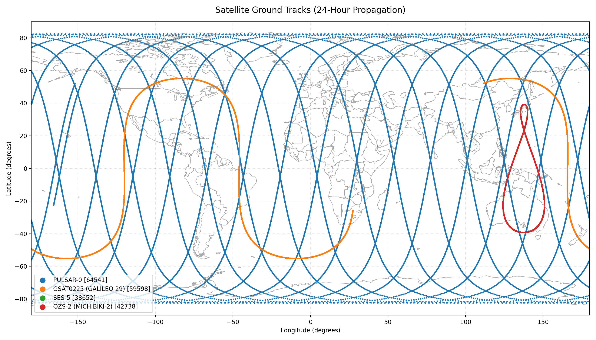
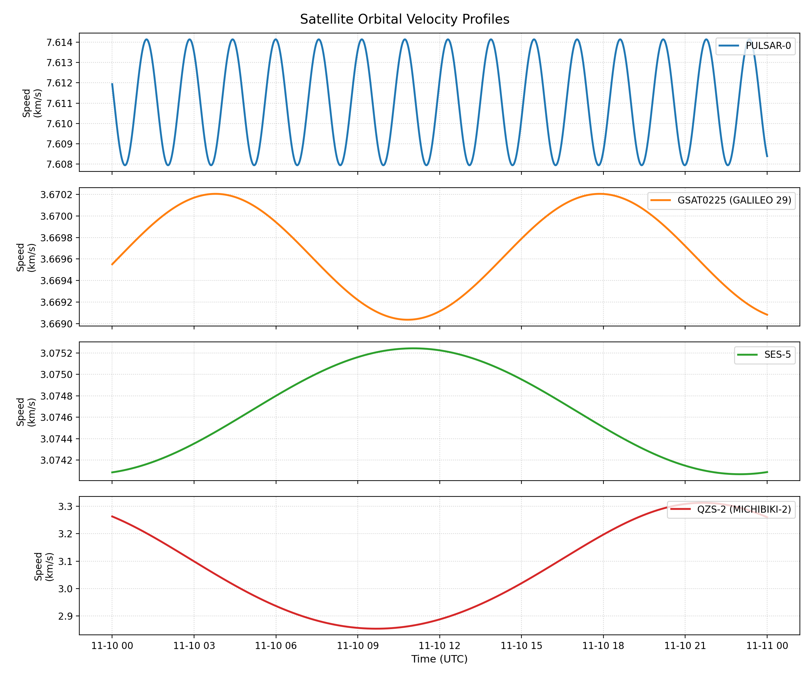

# 🛰️ Satellite Orbit Explorer

A Python-based satellite orbit visualization and analysis project developed during **Space Career Week 2026**, organized by **GNSS Academy**.

## 🌍 Project Overview

Satellite Orbit Explorer is an educational project focused on exploring satellite motion, orbital mechanics, and ground-track visualization using Python.

The project uses satellite orbital data to visualize trajectories, examine orbital characteristics, and generate outputs that can be explored through mapping tools.

## 🎯 Project Objectives

- Explore satellite orbital motion using Python.
- Visualize satellite ground tracks.
- Examine orbital velocity over time.
- Understand fundamental orbital mechanics concepts.
- Generate files for geospatial visualization.

## 🛠️ Tools & Technologies

- Python
- Jupyter Notebook / Google Colab
- Data visualization
- KML geospatial files

## 📊 Project Outputs

| File | Description |
|---|---|
| `ground_tracks.png` | Satellite ground-track visualization |
| `velocity_timeseries.png` | Orbital velocity over time |
| `orbit_tracks_ecef.kml` | Orbit track data in ECEF coordinates |
| `orbit_animation.kml` | KML animation for compatible mapping software |
| `orbit_report.txt` | Summary of orbital parameters |

### Visual Results

**Satellite Ground Tracks**

**Orbital Velocity Analysis**

## 💡 Learning Outcomes

Through this project, I explored the connection between programming and aerospace engineering, particularly satellite motion, orbital visualization, and the use of Python for space-related data analysis.

## 🙏 Acknowledgements

Special thanks to **GNSS Academy** for organizing Space Career Week 2026 and providing the opportunity to explore satellite engineering and space technologies.

---

*This project represents my learning journey in aerospace engineering and my growing interest in satellite systems and orbital mechanics.*
